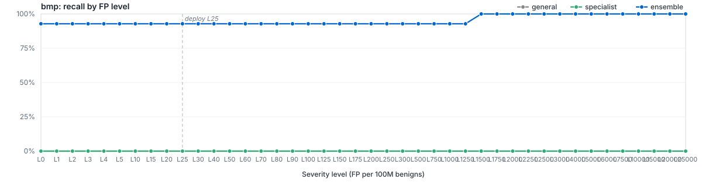

<<<<<<<< HEAD:filetypes/cab/README.md
# `filetype/cab`

LightGBM specialist for `cab`. Member of the Azoth routed ensemble; bundle root: [../..](../..).

## Ensemble Performance

Routed ensemble (general + filegroup + filetype where applicable) on the `cab` slice of the locked test partition: 102 malware / 13 benign (115 rows).

| PR AUC | ROC AUC | F1 | Recall @ L25 | Brier |
|---:|---:|---:|---:|---:|
| 0.998937 | 0.991704 | 0.990196 | — | 0.0946 |

## Specialist Performance

`filetypes/cab` specialist scored *alone* on the same slice (the ensemble usually does better — that's the point of the routing).

| PR AUC | ROC AUC | F1 | Recall @ L25 | Brier | Δ vs EMBER 2024 |
|---:|---:|---:|---:|---:|---:|
| 0.998937 | 0.991704 | 0.990196 | — | 0.0946 | — |

## Routing

Files matching `cab` are scored by `general`, `filetypes/cab`. The ensemble's per-row score is whatever combiner strategy (`specialist_priority`) the metrics step selected for this route. The per-level operating thresholds litmus applies on top live in [`route_policies.md`](../../route_policies.md).
========
# `filetype/bmp`

LightGBM specialist for `bmp`. Member of the Azoth routed ensemble; bundle root: [../..](../..).

## Ensemble Performance

Routed ensemble (general + filegroup + filetype where applicable) on the `bmp` slice of the locked test partition: 14 malware / 39 benign (53 rows).

| PR AUC | ROC AUC | F1 | Recall @ L25 | Brier |
|---:|---:|---:|---:|---:|
| 1.000000 | 1.000000 | 0.962963 | 92.86% | - |

## Specialist Performance

`filetypes/bmp` specialist scored alone on the same held-out slice, using its saved thresholds.

| PR AUC | ROC AUC | F1 | Recall @ L25 | Brier | Δ vs EMBER 2024 |
|---:|---:|---:|---:|---:|---:|
| 1.000000 | 1.000000 | 0.000000 | 0.00% | 0.0077 | — |

## Recall by FP level (per 100M benigns)

Each curve plots recall at the per-100M-benign FP target for the route. The vertical dashed line marks the L25 deploy operating point.

## Routing

Files matching `bmp` are scored by `filegroups/media`, `general`. The ensemble's decisions apply the saved routing policy, including every level at or below the requested level. Ranking metrics use the signed distance from that policy's decision boundary. See [`route_policies.md`](../../route_policies.md).
>>>>>>>> f29b4aba (new v21 bundle - experimental):filetypes/bmp/README.md

## Training

| Parameter | Value |
|---|---:|
| Algorithm | LightGBM binary classifier |
<<<<<<<< HEAD:filetypes/cab/README.md
| Train rows | 846 (759 mal / 87 ben) |
| Feature spec | 2114 features (`route_specific`) |
========
| Train rows | 298 (97 mal / 201 ben) |
| Feature spec | 193 features (`route_specific`) |
>>>>>>>> f29b4aba (new v21 bundle - experimental):filetypes/bmp/README.md
| n_estimators | 400 |
| num_leaves | 96 |
| max_depth | 12 |
| min_child_samples | 100 |
| learning_rate | 0.05 |
| subsample / colsample | 0.8 / 0.8 |
| reg_alpha / reg_lambda | 0.0 / 1.0 |
| early_stopping_rounds | 50 |
| device | auto |
