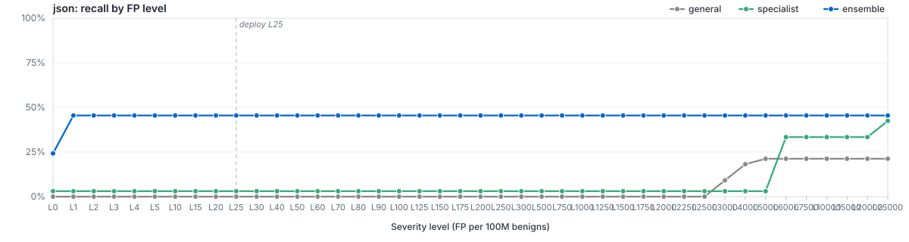

# `filetype/json`

LightGBM specialist for `json`. Member of the Azoth routed ensemble; bundle root: [../..](../..).

## Ensemble Performance

Routed ensemble (general + filegroup + filetype where applicable) on the `json` slice of the locked test partition: 33 malware / 39,064 benign (39,097 rows).

| PR AUC | ROC AUC | F1 | Recall @ L25 | Brier |
|---:|---:|---:|---:|---:|
| 0.558078 | 0.904786 | 0.625000 | 45.45% | - |

## Specialist Performance

`filetypes/json` specialist scored alone on the same held-out slice, using its saved thresholds.

| PR AUC | ROC AUC | F1 | Recall @ L25 | Brier | Δ vs EMBER 2024 |
|---:|---:|---:|---:|---:|---:|
| 0.429174 | 0.792339 | 0.058824 | 3.03% | 0.0007 | — |

## Recall by FP level (per 100M benigns)

Each curve plots recall at the per-100M-benign FP target for the route. The vertical dashed line marks the L25 deploy operating point.

## Routing

Files matching `json` are scored by `filegroups/config`, `filetypes/json`, `general`. The ensemble's decisions apply the saved routing policy, including every level at or below the requested level. Ranking metrics use the signed distance from that policy's decision boundary. See [`route_policies.md`](../../route_policies.md).

## Training

| Parameter | Value |
|---|---:|
| Algorithm | LightGBM binary classifier |
| Train rows | 234,334 (88 mal / 234,246 ben) |
| Feature spec | 2920 features (`route_specific`) |
| n_estimators | 320 |
| num_leaves | 128 |
| max_depth | 12 |
| min_child_samples | 150 |
| learning_rate | 0.05 |
| subsample / colsample | 0.8 / 0.8 |
| reg_alpha / reg_lambda | 0.0 / 2.0 |
| early_stopping_rounds | 25 |
| device | auto |
